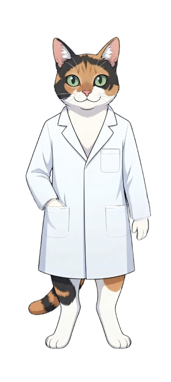
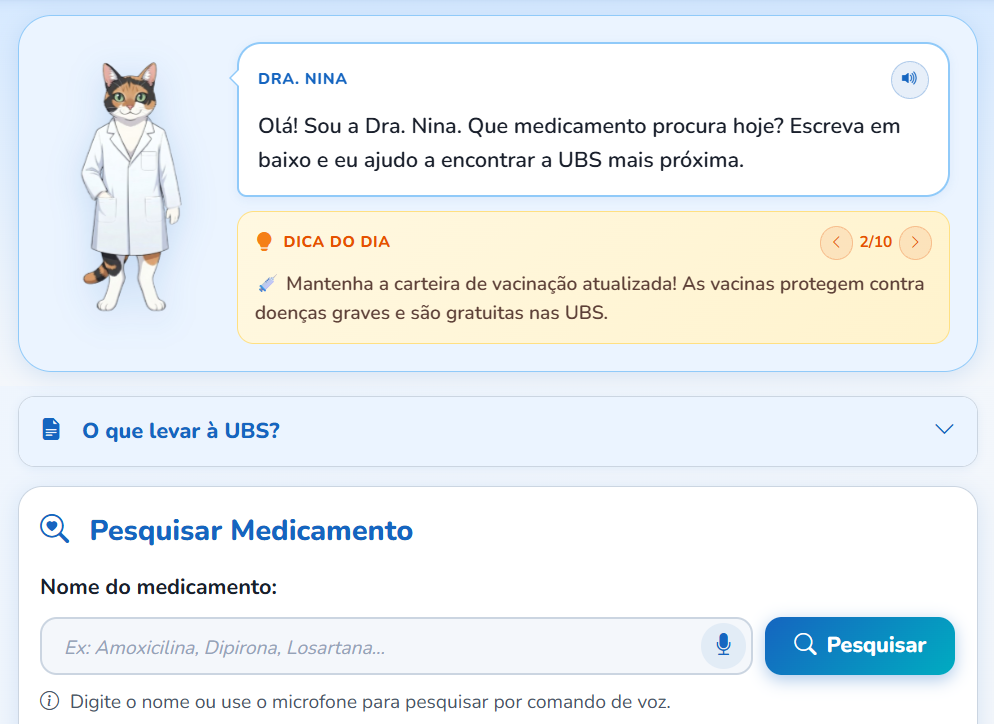
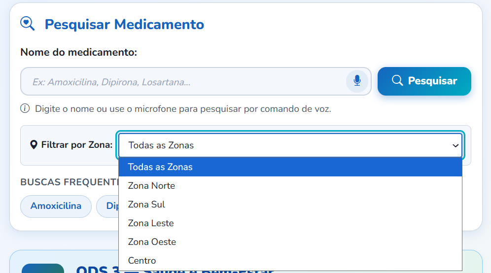
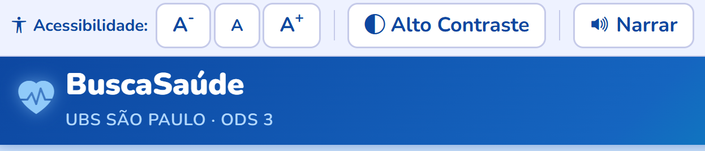
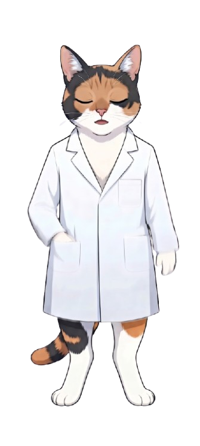

# 🏥 Busca Saúde - MVP Acadêmico

<p align="center">
  
</p>

<p align="center">
  <strong>Localizador acessível de medicamentos essenciais nas Unidades Básicas de Saúde (UBS) de São Paulo.</strong><br>
  FMU Tech Inovação 2026.2 · Cidadania Digital e Inclusão Social · ODS 3 (Saúde e Bem-Estar)
</p>

<p align="center">
  
  
  
  
  
  
</p>

## 📌 Protótipo MVP

O **Busca Saúde** é uma aplicação web (*Single Page Application*) que permite ao cidadão verificar rapidamente onde encontrar medicamentos da rede pública municipal antes de se deslocar até uma UBS, com suporte completo de voz e orientação guiada.

| Fluxo e Recursos | O que oferece |
|---|---|
| **Dra. Nina (Mascote Virtual)** | Assistente interativa em formato de gata calico com jaleco médico, animada por sprites (`neutra`, `falando`, `gesticulando`, `piscando`) e balões de diálogo contextuais |
| **Busca por Texto ou Voz** | Pesquisa instantânea do medicamento ou entrada por comando de voz via `SpeechRecognition` |
| **Leitura em Voz Alta** | Síntese de fala (`SpeechSynthesis`) com seleção inteligente de voz feminina natural em `pt-BR` para ler resultados e instruções |
| **Filtro Geográfico (SP)** | Segmentação por zonas de São Paulo (**Norte, Sul, Leste, Oeste e Centro**) com atalhos diretos para rotas no **Google Maps** e ligação telefônica |
| **Guia de Documentação** | Checklist visual dos documentos obrigatórios para retirada na UBS (RG, Cartão do SUS, Receita Médica e Comprovante de Residência) |
| **Dicas de Saúde Diárias** | Sistema rotativo com orientações preventivas e cuidados básicos alinhados ao ODS 3 |

### Prints da Interface

| Tela Inicial e Busca | Filtro por Zona e UBS | Acessibilidade e Alto Contraste |
|---|---|---|
|  |  |  |

### Acessibilidade implementada (WCAG 2.1 Nível AA)

| Diretriz | No protótipo |
|---|---|
| **Controle Tipográfico** | Barra dedicada para redimensionamento dinâmico das fontes (`A-`, `A`, `A+`) |
| **Conforto Visual** | Modo **Alto Contraste** integrado via CSS Design Tokens (`:root`) |
| **Comunicação Múltipla** | Pesquisa por comando de voz e leitura em áudio de todos os resultados e alertas |
| **Navegação Assistiva** | *Skip Link* para navegação rápida por teclado, HTML5 semântico e marcações **ARIA** dinâmicas para leitores de tela |
| **Responsividade** | Arquitetura *Mobile First* projetada para uso confortável em celulares de pacientes e idosos |
| **Privacidade** | Sem login, sem coleta de dados pessoais e sem rastreamento; preferências visuais salvas apenas no `localStorage` do dispositivo |

## 🚀 Como Executar o Projeto Localmente
Por se tratar de uma aplicação puramente front-end baseada em arquivos estáticos (HTML, CSS, JS e imagens), você pode executá-la de duas maneiras simples:

Opção 1: Abertura Direta
 * Baixe ou clone este repositório em sua máquina.
 * Dê um duplo clique no arquivo index.html para abri-lo diretamente no seu navegador padrão (Google Chrome ou Microsoft Edge recomendados para suporte completo à voz).

Opção 2: Servidor Local (Recomendado para recursos de áudio e microfone)
Caso utilize o VS Code, instancie um servidor de desenvolvimento local:
 * Abra a pasta do projeto no VS Code.
 * Instale a extensão Live Server (por Ritwick Dey).
 * Clique com o botão direito em index.html e selecione "Open with Live Server".

## 🛠️ Tecnologias Utilizadas
O projeto foi construído de forma enxuta, sem dependências de frameworks pesados, garantindo alta performance e carregamento instantâneo:
 * HTML5 Semantic: Estrutura acessível com tags semânticas e atributos ARIA robustos.
 * CSS3 Moderno:
   * Design Tokens (:root) para cores, espaçamentos e escalas tipográficas.
   * Layout responsivo com Flexbox e CSS Grid (Mobile First).
   * Animações fluidas otimizadas com @keyframes.
 * JavaScript (ES6+ Modular):
   * Manipulação assíncrona do DOM.
   * Integração nativa com a Web Speech API (reconhecimento e síntese de voz).
   * Gerenciamento de estado local (localStorage).
 * Bootstrap 5.3 & Bootstrap Icons: Estilização base de componentes utilitários e ícones vetoriais.
 * Google Fonts (Nunito): Tipografia limpa e altamente legível para públicos de todas as idades.

## ⚠️ Descrição do problema

### O problema

Pacientes do Sistema Único de Saúde (SUS) — especialmente idosos, pessoas com mobilidade reduzida e cidadãos de baixa renda em grandes metrópoles como São Paulo — frequentemente enfrentam deslocamentos longos e custosos até uma Unidade Básica de Saúde (UBS) apenas para descobrir que o medicamento prescrito está em falta naquela unidade.

Além da barreira logística, muitos portais públicos possuem interfaces complexas, letras pequenas e ausência de suporte auditivo, dificultando o acesso autônomo à informação por pessoas com baixa visão, dificuldades de leitura ou pouca familiaridade digital.

### Recorte e Público-Alvo

O **Busca Saúde** não realiza prescrição médica nem substitui o atendimento profissional. É uma **ferramenta de cidadania digital e orientação logística**, desenhada para democratizar o acesso à informação pública.

> **Pergunta do projeto:** como uma interface web acessível, guiada por voz e apoiada por uma assistente virtual pode reduzir deslocamentos desnecessários e facilitar a busca por medicamentos na rede pública de São Paulo?

| Perfil | Papel no ecossistema |
|---|---|
| **Usuário principal** | Cidadãos de São Paulo, pacientes do SUS, idosos e pessoas com deficiência visual ou motora |
| **Mediadores** | Familiares, cuidadores, agentes comunitários de saúde e atendentes de recepção das UBSs |
| **Contexto de uso** | Acesso rápido via smartphone (*Mobile First*) ou computador antes de sair de casa |

---

## ⚠️ Proposta de solução tecnológica

### Como a solução ataca o problema

O sistema elimina a fricção na consulta de medicamentos através de um fluxo direto e assistido pela **Dra. Nina**:

BUSCA     →  O usuário digita ou fala o nome do medicamento no microfone

FILTRO    →  Seleciona a região de São Paulo (Norte, Sul, Leste, Oeste ou Centro)

RESULTADO →  Visualiza e ouve quais UBSs têm disponibilidade, com botão direto para rota no Maps ou telefone
↓
APOIO EXTRA:    Checklist visual de documentos obrigatórios + Dicas diárias de saúde preventiva

### Diferenciais arquiteturais

* **Zero dependências pesadas:** Construído em HTML, CSS e JavaScript puros para garantir carregamento instantâneo mesmo em conexões móveis 3G/4G instáveis.
* **Inclusão desde a concepção:** Recursos de alto contraste, aumento de fonte e leitura em voz alta integrados nativamente na barra superior, sem depender de plugins externos.

---

## 🐱 Identidade visual e mascote

### A Mascote: Dra. Nina

Para humanizar o atendimento digital e tornar a navegação mais acolhedora — especialmente para idosos e usuários com insegurança tecnológica — foi criada a **Dra. Nina**, uma personagem original em estilo cartoon/anime (gata calico vestindo jaleco médico).

| Neutra | Falando | Gesticulando | Piscando |
|---|---|---|---|
|  |  |  |  |

As expressões mudam dinamicamente via JavaScript conforme o estado da interação (aguardando busca, falando resultados por áudio ou orientando sobre documentos).

### Tipografia e Contraste

* **Fonte principal:** **Nunito** (Google Fonts), escolhida por suas formas abertas e excelente legibilidade em telas pequenas.
* **Sistema de Cores:** Gerenciado via variáveis CSS (`:root`), permitindo alternância imediata entre o tema padrão suave e o tema de **Alto Contraste** (conformidade WCAG 2.1 AA).

## 🌍 Alinhamento com o ODS 3 da ONU
O BuscaSaúde atua diretamente em pilares fundamentais dos Objetivos de Desenvolvimento Sustentável:
 * Meta 3.8: Alcançar a cobertura universal de saúde e o acesso a serviços de saúde essencial de qualidade.
 * Meta 3.b: Apoiar a pesquisa e o desenvolvimento de vacinas e medicamentos para doenças transmissíveis e não transmissíveis, proporcionando acesso a medicamentos essenciais acessíveis.
 * Meta 3.d: Reforçar a capacidade de alerta precoce e gestão de riscos para a saúde nacional e global.

## 🔍 Transparência de Dados
Nota: As informações de estoque e disponibilidade exibidas neste sistema tratam-se de dados simulados para fins de prototipagem acadêmica e validação de interface, estruturados com base nos parâmetros oficiais da Secretaria Municipal de Saúde de São Paulo (SMS-SP). Para dados reais e em tempo real, consulte sempre o portal oficial da Prefeitura ou a unidade de saúde da sua região.

## 🛡️ Licença e Autoria
Desenvolvido com dedicação como projeto universitário voltado à inovação social e cidadania digital em São Paulo, SP.
 * Ano: 2026
 * Público-alvo: Cidadãos de São Paulo, pacientes do SUS, idosos e estudantes de tecnologia focados em impacto social.

## 📁 Organização do repositório

```text
Busca_Saude/
├── README.md               ← Apresentação e documentação principal do projeto de software
├── index.html              ← Estrutura principal da aplicação (SPA) e marcação semântica ARIA
├── style.css               ← Design Tokens (:root), layout Mobile First, animações e Alto Contraste
├── script.js               ← Lógica de busca, base simulada SMS-SP, sprites e Web Speech API
├── nina_neutra.png         ← Sprite padrão da Dra. Nina
├── nina_falando.png        ← Sprite sincronizado com a síntese de voz
├── nina_gesticulando.png   ← Sprite de orientação e destaque
├── nina_piscando.png       ← Sprite de animação orgânica
└── docs/
    └── prints/             ← Capturas de tela da interface


